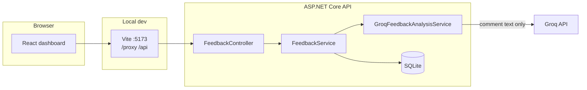

# FeedbackAI

Full-stack portfolio project for **collecting customer feedback**, viewing analytics on a React dashboard, and **analyzing comments with AI** (sentiment, category, short summary) via the Groq API. Only feedback **comments** are sent to the model—never customer names or emails.

## Features

| Area | Capabilities |
|------|----------------|
| **Dashboard** | Total feedback count, average rating, 1–5 star distribution |
| **Feedback CRUD** | Create, list, edit, and delete entries with validation |
| **List controls** | Filter by rating, paginated list |
| **AI analysis** | On-demand **Analyze** — Positive / Neutral / Negative, Product / Delivery / Customer Service / Other, brief summary |
| **Operations** | SQLite persistence, Docker image, GitHub Actions (API tests + frontend build) |

CRUD works without configuring AI. Analysis is optional and server-gated (API key on the backend only).

## Technology stack

| Layer | Technologies |
|-------|----------------|
| **API** | ASP.NET Core (.NET 10), EF Core, SQLite, FluentValidation, RFC 7807 problem details |
| **AI** | Groq Chat Completions (`openai/gpt-oss-20b`), JSON Object Mode |
| **Frontend** | React 19, TypeScript, Vite 8 |
| **Tests** | xUnit, `WebApplicationFactory`, mocked `IFeedbackAnalysisService` |
| **Deploy (demo)** | Multi-stage Dockerfile, Docker Compose, non-root container user |

## Architecture



Request flow for analysis:

1. User clicks **Analyze** in the UI → `POST /api/feedback/{id}/analyze`.
2. API loads the feedback row and calls `IFeedbackAnalysisService` with **only** `comment`.
3. Groq returns JSON (`sentiment`, `category`, `summary`); the API validates and normalizes values, then stores them on the feedback record.
4. Responses include an optional `analysis` object on list/get. Editing the **comment** clears stored analysis.

## Prerequisites

- [.NET 10 SDK](https://dotnet.microsoft.com/download)
- [Node.js](https://nodejs.org/) 20+
- Optional: [dotnet-ef](https://learn.microsoft.com/ef/core/cli/dotnet) for manual migrations
- Optional: [Groq](https://console.groq.com/) API key for live AI analysis

```bash
dotnet tool install dotnet-ef --version 10.0.0
```

## Setup and run

### 1. API

```bash
dotnet run --project CustomerFeedback.Api
```

- Development URL: `http://localhost:5047` (see `launchSettings.json`).
- EF migrations run automatically in Development; database file: `feedback.db` (gitignored).
- OpenAPI (Development): `/openapi/v1.json`.

### 2. Groq API key (server only)

Never commit keys or put them in the frontend.

| Method | Example |
|--------|---------|
| Environment variable | `Groq__ApiKey=your-key` |
| User secrets | `dotnet user-secrets set "Groq:ApiKey" "your-key" --project CustomerFeedback.Api` |

Optional (`appsettings.json` → `Groq`, or `Groq__Model`, `Groq__TimeoutSeconds`):

| Setting | Default |
|---------|---------|
| `Model` | `openai/gpt-oss-20b` (JSON Object Mode via `response_format: { "type": "json_object" }`) |
| `TimeoutSeconds` | `30` |
| `BaseUrl` | `https://api.groq.com/openai/v1` |

### 3. Frontend

```bash
cd frontend
npm install
npm run dev
```

Open `http://localhost:5173`. Vite proxies `/api` to `http://127.0.0.1:5047` so the browser stays on one origin. See `frontend/.env.example` for optional overrides.

### Production-style frontend build

```bash
cd frontend
npm run build
npm run preview
```

Keep the API running; `preview` uses the same `/api` proxy as dev.

## API reference

| Method | Path | Description |
|--------|------|-------------|
| GET | `/api/feedback?page=&pageSize=&rating=` | List (newest first); optional rating filter |
| GET | `/api/feedback/{id}` | Get by id |
| POST | `/api/feedback` | Create |
| PUT | `/api/feedback/{id}` | Update |
| DELETE | `/api/feedback/{id}` | Delete |
| POST | `/api/feedback/{id}/analyze` | AI analysis |

Analysis errors: `503` (not configured), `502` (provider/invalid JSON), `504` (timeout).

## AI workflow (privacy)

1. **Input to Groq:** comment string + a fixed system prompt (no PII).
2. **Output:** JSON with sentiment, category, summary — parsed and constrained to allowed labels.
3. **Storage:** persisted on the feedback row; exposed as `analysis` in API responses.
4. **Dashboard:** **Analyze** button per row; badges and summary when present.

## Tests

```bash
dotnet test
```

27 tests: FluentValidation unit tests, CRUD integration tests, analysis tests with `FakeFeedbackAnalysisService` (no live Groq calls).

```bash
cd frontend && npm run build
```

## Docker (API only)

```bash
docker build -t feedbackai-api .
docker compose up --build
```

API: `http://127.0.0.1:8080`. Pass `Groq__ApiKey` via Compose or runtime env if you want analysis in containers.

## Repository layout

| Path | Role |
|------|------|
| `CustomerFeedback.Api/` | REST API, EF Core, Groq integration (`Analysis/`) |
| `CustomerFeedback.Tests/` | Unit and integration tests |
| `frontend/` | FeedbackAI dashboard |
| `.github/workflows/ci.yml` | Build, test, NuGet audit, frontend build |

Solution file: `CustomerFeedback.slnx` (project names retained for stable paths; product branding is **FeedbackAI**).

## Security and secrets audit

**Working tree:** No API keys, tokens, or `.env` files with secrets are present. Groq keys are expected via environment or user secrets only.

**Git history (reviewed):** No `gsk_` / Groq-style key material found; only documentation placeholders such as `your-key`. Commit messages contain no employer or interview-specific naming.

**Configuration hygiene:**

- `appsettings.json` does not contain `Groq:ApiKey`.
- Frontend uses relative `/api` and optional `VITE_*` vars (see `frontend/.env.example`); no Groq key on the client.
- `.gitignore` excludes `*.db`, build output, and local env files (see below).

If you ever committed a real key, rotate it at Groq and rewrite history or use `git filter-repo` before publishing.

## Production limitations (honest scope)

This repo is a **portfolio / demo**, not production-hardened software:

| Topic | Current state |
|-------|----------------|
| **Authentication** | None — anyone with API access can read/write feedback |
| **Authorization** | None |
| **Database** | SQLite — single-file, best for one instance; not ideal for high concurrency or multi-node |
| **Dashboard stats** | Client aggregates by paging the list API (no dedicated stats endpoint; can be slow at large volume) |
| **Pagination** | No total count; UI uses next/prev heuristics |
| **AI** | External Groq dependency; rate limits and cost apply; no queue or retry UI |
| **PII** | Names and emails stored in SQLite without field-level encryption |
| **HTTPS / CORS** | Local dev relies on Vite proxy; production would need TLS and an explicit API gateway or CORS policy |
| **Observability** | Basic logging only — no metrics, tracing, or alerting |
| **Frontend hosting** | Static build has no built-in API; must pair with the API and proxy or CORS deliberately |

Reasonable next steps for a real deployment: identity (e.g. OpenID Connect), managed SQL, secrets manager, rate limiting, and async analysis jobs.

## Database migrations

```bash
dotnet ef database update --project CustomerFeedback.Api
dotnet ef migrations add <Name> --project CustomerFeedback.Api --output-dir Migrations
```

## License

Add a license file before publishing if you intend to open-source this repository publicly.